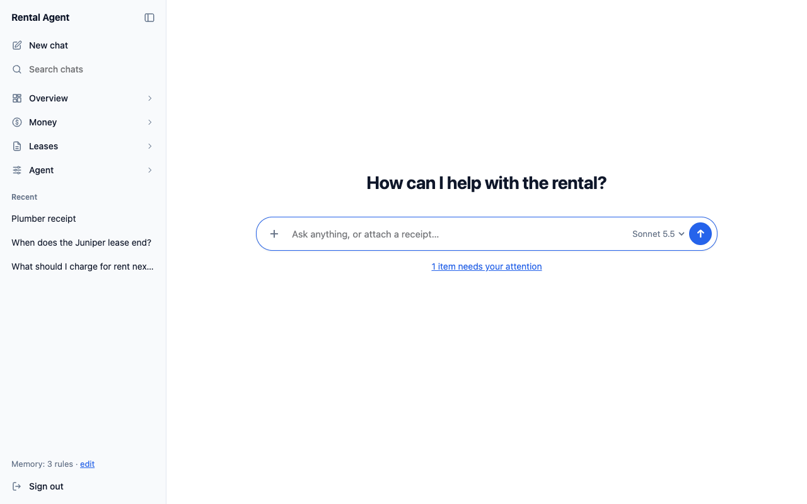

# Rental Agent

*Demo with made-up data.*

Rental Agent is a private, self-hosted web app that runs the paperwork of a small rental-property
LLC with Claude. It runs in Docker on your own Mac, keeps its records in Supabase (Postgres), and
gives you a chat where you can ask about your leases and local rental rules, attach receipts or
bank statements to record rent and expenses, and import leases and LLC documents. Scheduled jobs
pull rent and expense emails from Gmail, recommend next year's rent from comparable listings,
fill in the yearly lease extension as a PDF, and build the year-end Schedule E summary. Nothing
is written to your records until you confirm it.

Use it if you own one or a few rental properties, usually through a single-member LLC, and want
to replace spreadsheets and scattered email with one place that tracks rent, expenses, tenants
and lease terms, reminds you of renewal deadlines, and hands your CPA clean year-end numbers. It
was built for a townhouse in Plano, Texas, but the state-specific defaults (notice period, lease
form, time zone, email senders) are easy to change. See [SETUP.md](SETUP.md) for installation,
configuration and day-to-day use.
